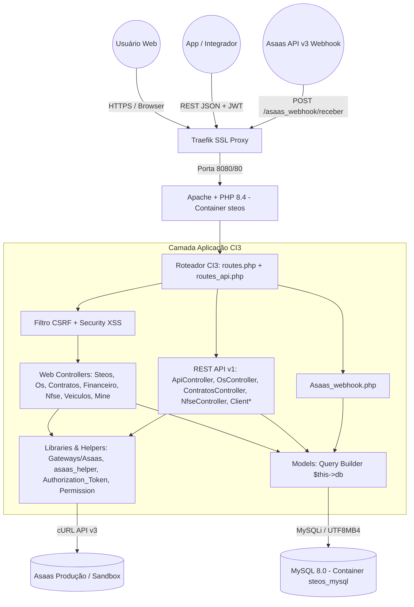

# Arquitetura Geral do Sistema STEOS v4.53.2

Este documento descreve a arquitetura atualizada do sistema **STEOS**, construído em **PHP 8.4** sobre o framework **CodeIgniter 3 (MVC estrito)**, banco **MySQL 8.0**, orquestração **Docker / Traefik**, integração nativa com **Asaas API v3 (Cobranças, Assinaturas, Webhooks e NFS-e Portal Nacional + IBS/CBS)** e **API RESTful v1 (JWT)**.

## Diagrama de Arquitetura e Fluxo de Execução

## Descrição das Camadas
- **Segurança, Roteamento & ACL Granular (92 Chaves):** `routes.php` mantém auto-routing para controllers tradicionais, mapeia rotas explícitas em lowercase para controllers CamelCase (blindagem Linux case-sensitive) e carrega `routes_api.php` quando `API_ENABLED=true`. O controle de acesso funciona em **3 camadas sincronizadas** via `Permission::checkPermission()` (**92 chaves granulares** em JSON na tabela `permissoes`, migration `20261122153000`): (1) Controllers Web (`MY_Controller`), (2) Views/Menus (`menu.php`, `topo.php` e botões/abas), e (3) API RESTful v1 (`HTTP 401`). Requisições web POST usam proteção CSRF gerenciada via `assets/js/csrf.js` (`$.ajaxPrefilter`), Webhooks Asaas usam `hash_equals()` sobre `asaas-access-token` e a API v1 usa JWT Bearer (`Authorization_Token`).
- **Regra Arquitetural Obrigatória de ACL:** Todo novo módulo, controller, ação AJAX ou endpoint da API adicionado ao STEOS deve implementar granulação de permissões ACL (`v/a/e/d/r/c`), migration idempotente sem lockout para `Administrador`, UI em `Permissoes`, guards nas 3 camadas e atualização em `.specs/`.
- **Controllers & Regras de Negócio:** Orquestram ACL (`Permission`), `form_validation`, emissão fiscal/financeira e transações DB (`trans_begin`/`trans_commit`/`trans_rollback`).
- **Libraries & Helpers (`Asaas.php` + `asaas_helper.php`):** Encapsulam chamadas cURL à API v3 do Asaas, detecção do Portal Nacional (`useNationalPortal`), sanitização de códigos IBS/CBS (`federalServiceTaxCode` vs `operationIndicatorCode`) e conciliação automática de cobranças/NFS-e.
- **Models & Persistência (`MySQL 8.0`):** Isolamento estrito de queries via Query Builder; migrações versionadas em `application/database/migrations/` e sincronia de schema em `migrations/schema_snapshot.json` via `Tools.php`.
- **Views (`application/views/`):** Interface responsiva em Bootstrap 4, jQuery, DataTables, FullCalendar, Chart.js e SweetAlert2, incluindo área administrativa e Portal do Cliente Conecte (`Mine`).
