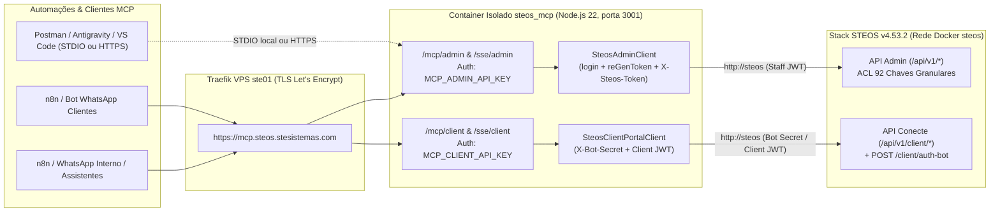

# Servidor MCP Privado STEOS (`steos-mcp`)

Servidor **Model Context Protocol (MCP)** privado para o **STEOS v4.53.2** em Node.js 22 (`@modelcontextprotocol/sdk` + Express + Zod), construído diretamente sobre a API RESTful v1 (`/index.php/api/v1/*`), mantendo privacidade total do código/endpoints e compatibilidade nativa com **n8n**, **WhatsApp bots**, **Postman (MCP/AI Requests)** e **IDEs (Antigravity, VS Code, Cursor, Claude Desktop)**.

---

## 1. Arquitetura Dual com Isolamento Estrito



### Garantias de Segurança e Isolamento
1. **Chaves de API separadas e obrigatórias em HTTP:** `/mcp/admin` e `/sse/admin` exigem `MCP_ADMIN_API_KEY`; `/mcp/client` e `/sse/client` exigem `MCP_CLIENT_API_KEY` (comparação via SHA-256 + `crypto.timingSafeEqual`).
2. **Separação estrita `staff` vs `client` no JWT do STEOS:** `REST_Controller` rejeita tokens `type=client` nos endpoints administrativos e tokens `type=staff`/`permissao` no Portal do Cliente (`HTTP 403`).
3. **Sessões SSE isoladas:** mapas separados `adminSseSessions` e `clientSseSessions` impedem uso cruzado de `sessionId`.
4. **Nenhuma operação `DELETE`:** exclusões permanecem fora do servidor MCP.
5. **Logs limpos e seguros:** auditoria JSON gravada exclusivamente em `stderr` (nunca polui `stdout` do STDIO), mascarando tokens, JWTs, senhas e CPF/CNPJ.
6. **Bot Auth blindado (`/api/v1/client/auth-bot`):** exige `X-Bot-Secret` (`hash_equals()`), normaliza CPF/CNPJ (rejeita sequências repetidas como `00000000000`) + telefone (DDI `55`, DDD e 9º dígito), aplica rate-limit (5 falhas / 15 min → `HTTP 429`), grava auditoria e emite JWT curto de 30 min (`exp_ttl = 1800`).

---

## 2. Endpoints & Transportes

| Modo / Transporte | Endpoint Admin | Endpoint Cliente | Observações |
| :--- | :--- | :--- | :--- |
| **Healthcheck** | `GET /health` | `GET /health` | Público interno/externo sem dados sensíveis |
| **Streamable HTTP (Stateless)** | `POST /mcp/admin` | `POST /mcp/client` | Padrão MCP atual (ideal para n8n moderno; `GET`/`DELETE` retornam `405`) |
| **SSE Legado** | `GET /sse/admin` + `POST /messages/admin` | `GET /sse/client` + `POST /messages/client` | Compatibilidade com nós `MCP Client Tool` antigos do n8n |
| **STDIO Local** | `node mcpServer.js` | `node mcpServer.js --client` | Uso local em IDEs / Postman MCP STDIO |

### Cabeçalhos Suportados
- Autenticação MCP (obrigatório em HTTP/SSE): `Authorization: Bearer <MCP_ADMIN_API_KEY|MCP_CLIENT_API_KEY>` ou `X-API-Key: <chave>`.
- Overrides opcionais:
  - `X-Steos-Token`: no escopo Admin, permite encaminhar o JWT de um usuário STEOS específico em vez da conta de serviço padrão.
  - `X-Client-Token`: no escopo Cliente, permite ao n8n injetar diretamente o JWT do cliente sem passar `session_token` nas ferramentas.

---

## 3. Catálogo de Tools (31 Admin + 10 Cliente)

### Escopo Admin (`/mcp/admin`)

#### Onda 1 — Somente Leitura (23 tools, sempre ativas)
| Tool | Endpoint STEOS | Permissão ACL |
| :--- | :--- | :--- |
| `steos_dashboard_resumo` | `GET /api/v1` | Staff autenticado + `vOs` |
| `steos_calendario_os` | `GET /api/v1/calendario` | `vOs` |
| `steos_emitente_info` | `GET /api/v1/emitente` | Staff autenticado |
| `steos_listar_clientes` | `GET /api/v1/clientes` | `vCliente` |
| `steos_detalhar_cliente` | `GET /api/v1/clientes/{id}` | `vCliente` |
| `steos_listar_produtos` | `GET /api/v1/produtos` | `vProduto` |
| `steos_listar_servicos` | `GET /api/v1/servicos` | `vServico` |
| `steos_listar_os` | `GET /api/v1/os` | `vOs` |
| `steos_detalhar_os` | `GET /api/v1/os/{id}` | `vOs` |
| `steos_listar_checklists_os` | `GET /api/v1/os/{id}/checklists` | `vOs` |
| `steos_listar_contratos` | `GET /api/v1/contratos` | `vContrato` |
| `steos_detalhar_contrato` | `GET /api/v1/contratos/{id}` | `vContrato` |
| `steos_listar_cobrancas` | `GET /api/v1/cobrancas` | `vCobranca` |
| `steos_obter_pix_cobranca` | `GET /api/v1/cobrancas/{id}/pix` | `vCobranca` |
| `steos_listar_nfse` | `GET /api/v1/nfse` | `vNfse` |
| `steos_consultar_nfse` | `GET /api/v1/nfse/consultar/{osId}` | `vNfse` |
| `steos_listar_servicos_nfse` | `GET /api/v1/nfse/servicos` | `vNfse` |
| `steos_listar_financeiro` | `GET /api/v1/financeiro` | `vLancamento` |
| `steos_resumo_financeiro` | `GET /api/v1/financeiro/resumo` | `vLancamento` |
| `steos_listar_veiculos` | `GET /api/v1/veiculos` | `vVeiculo` |
| `steos_detalhar_veiculo` | `GET /api/v1/veiculos/{id}` | `vVeiculo` |
| `steos_listar_vendas` | `GET /api/v1/vendas` | `vVenda` |
| `steos_detalhar_venda` | `GET /api/v1/vendas/{id}` | `vVenda` |

#### Onda 2 — Escrita Operacional (6 tools, requer `MCP_ENABLE_WRITE=true`)
| Tool | Endpoint STEOS | Permissão ACL | Observações |
| :--- | :--- | :--- | :--- |
| `steos_criar_os` | `POST /api/v1/os` | `aOs` | Converte datas `YYYY-MM-DD` → `DD/MM/YYYY` |
| `steos_atualizar_os` | `PUT /api/v1/os/{id}` | `eOs` | Converte datas `YYYY-MM-DD` → `DD/MM/YYYY` |
| `steos_adicionar_anotacao_os` | `POST /api/v1/os/{id}/anotacoes` | `eOs` | |
| `steos_adicionar_produto_os` | `POST /api/v1/os/{id}/produtos` | `eOs` | Atualiza estoque conforme `control_estoque` |
| `steos_adicionar_servico_os` | `POST /api/v1/os/{id}/servicos` | `eOs` | |
| `steos_criar_cliente` | `POST /api/v1/clientes` | `aCliente` | Valida CPF/CNPJ e unicidade no backend |

#### Onda 3 — Ações Fiscais Críticas (2 tools, requer `MCP_ENABLE_FISCAL_WRITE=true` + `confirm: true`)
| Tool | Endpoint STEOS | Permissão ACL | Observações |
| :--- | :--- | :--- | :--- |
| `steos_emitir_nfse` | `POST /api/v1/nfse/emitir/{osId}` | `aNfse` | Rejeita se `confirm !== true` |
| `steos_cancelar_nfse` | `POST /api/v1/nfse/cancelar/{osId}` | `dNfse` | Rejeita se `confirm !== true` |

### Escopo Cliente (`/mcp/client` — 10 tools isoladas por `clientes_id`)
1. `steos_cliente_autenticar` (`POST /api/v1/client/auth-bot`)
2. `steos_cliente_autenticar_email` (`POST /api/v1/client/auth`)
3. `steos_cliente_resumo` (`GET /api/v1/client`)
4. `steos_cliente_listar_os` (`GET /api/v1/client/os`)
5. `steos_cliente_detalhar_os` (`GET /api/v1/client/os/{id}`)
6. `steos_cliente_abrir_os` (`POST /api/v1/client/os`)
7. `steos_cliente_listar_contratos` (`GET /api/v1/client/contratos`)
8. `steos_cliente_detalhar_contrato` (`GET /api/v1/client/contratos/{id}`)
9. `steos_cliente_listar_cobrancas` (`GET /api/v1/client/cobrancas`)
10. `steos_cliente_listar_compras` (`GET /api/v1/client/compras`)

---

## 4. Variáveis de Ambiente (`mcp-server/.env`) & Conta de Serviço

- A migration `20261122170000_add_mcp_service_profile.php` (espelho SQL `migrations/sql/027_add_mcp_service_profile.sql`) cria:
  - Perfil ACL **`API MCP Admin`** (27 chaves ativas entre leitura `v*`, escrita operacional `a/eCliente`, `a/eOs` e `a/e/dNfse`; zero chaves `c*`, `r*` ou `d*` não fiscais).
  - Usuário de serviço **`mcp.service@stesistemas.com`** (`Agente MCP STEOS`, validade `2035-12-31`).
- Em produção (`/docker/steos-mcp/.env`):
  - `MCP_ENABLE_WRITE=true` (Ondas 1 + 2 ativas por padrão).
  - `MCP_ENABLE_FISCAL_WRITE=false` (Onda 3 desligada por padrão até liberação explícita).

---

## 5. Guias Rápidos de Conexão

### A) n8n (`MCP Client Tool`)
- **Fluxo Administrativo / Equipe Interna:**
  - **Server Transport:** `HTTP Streamable` (ou `SSE` legado se a versão do n8n exigir)
  - **Endpoint URL:** `https://mcp.steos.stesistemas.com/mcp/admin` (ou `/sse/admin` no SSE legado)
  - **Authentication:** Header Auth → `Authorization: Bearer <MCP_ADMIN_API_KEY>`
- **Fluxo Atendimento ao Cliente (Bot WhatsApp):**
  - **Endpoint URL:** `https://mcp.steos.stesistemas.com/mcp/client` (ou `/sse/client` no SSE legado)
  - **Authentication:** Header Auth → `Authorization: Bearer <MCP_CLIENT_API_KEY>`
  - **Prompt recomendado para o Agente Cliente:** instruir o agente a solicitar CPF/CNPJ e conferir com o telefone do contato chamando `steos_cliente_autenticar`, guardar o `session_token` em memória da conversa e passá-lo em todas as chamadas de O.S., contratos e cobranças.

### B) Postman (`MCP Request` e `AI Request`)
- **Streamable HTTP:** criar *MCP Request* tipo `HTTP` apontando para `https://mcp.steos.stesistemas.com/mcp/admin` (ou `http://localhost:3001/mcp/admin`) com header `Authorization: Bearer <MCP_ADMIN_API_KEY>`.
- **STDIO Local:** criar *MCP Request* tipo `STDIO` executando:
  `node "e:/DEV/EMISSOR DE NOTAS/STEOS/mcp-server/mcpServer.js"`

### C) Antigravity / VS Code / Cursor (`mcp_config.json`)
```json
{
  "mcpServers": {
    "steos-admin": {
      "command": "node",
      "args": ["e:/DEV/EMISSOR DE NOTAS/STEOS/mcp-server/mcpServer.js"]
    }
  }
}
```
*(Em produção remota via HTTP Streamable, utilize `https://mcp.steos.stesistemas.com/mcp/admin` com `Authorization: Bearer <MCP_ADMIN_API_KEY>`.)*

---

## 6. Comandos Locais e Deploy Isolado VPS

```powershell
# Desenvolvimento local (pasta mcp-server/)
npm run list-tools
npm run test:smoke
npm run start:http
```

```bash
# Produção na VPS ste01 (stack isolado sem tocar em /docker/steos/docker-compose.yml)
docker compose -p steos-mcp -f /docker/steos/mcp-server/docker-compose.mcp.yml --env-file /docker/steos-mcp/.env up -d --build
```
